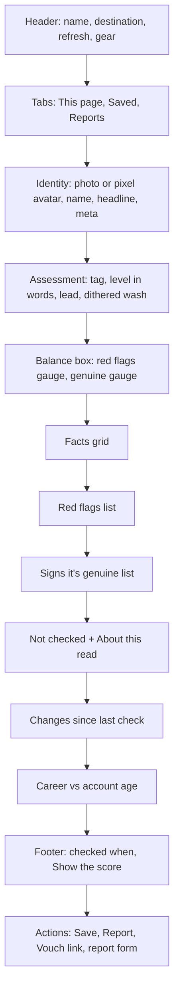
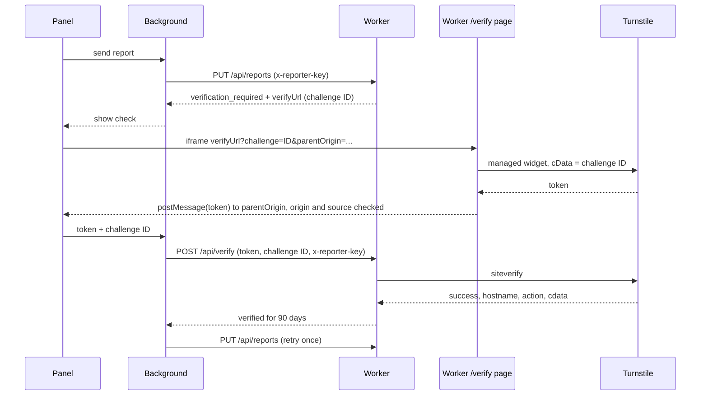
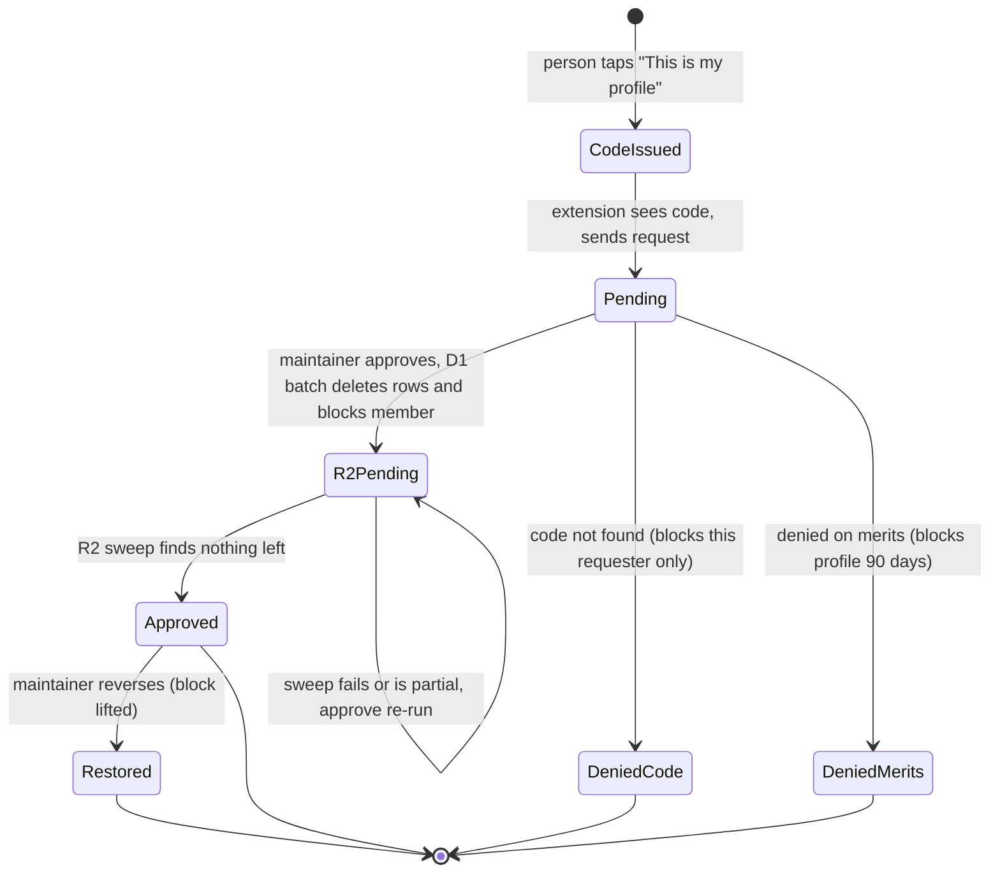
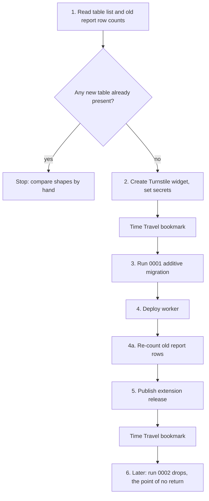

# Panel Redesign, Reports Live and Abuse Guards - Plan

## Goal Capsule

- **Objective:** People using Fake Profile Reporter get a side panel that shows at a glance what counts against and for a profile, company or job. They can report, change, withdraw or vouch, and those reports reach the shared database. The shared database is protected against scripted floods, and anyone whose profile is listed can ask for it to be removed.
- **Means:** one release that rebuilds the panel to the settled prototype (Key Decisions), takes the already-built reports v2 live through a split migration (KTD9), adds a level floor for the changed-hands pattern (KTD2), and adds a bot check (KTD6) and a removal request reviewed by the maintainer (KTD8).
- **Authority:** Product Contract Requirements own behavior. KTDs own mechanism. The prototype (`docs/design/prototype/2026-11-23-score-and-report.ItbJll/`) owns visual detail where this plan is silent. AGENTS.md guards override everything here.
- **Stop conditions:**
  - Stop if a remote step needs a grant that hasn't been given this session: a remote D1 read or write, a deploy, a store upload, or a secret.
  - Stop if the production schema check (Operational Notes, step 1) finds any of the new tables already present.
  - Stop if Turnstile can't render inside the iframe on Chrome.
  - Never run `wrangler d1 migrations apply` or `db:init` against the live database.
- **Execution profile:** code. TypeScript across `packages/core`, `apps/worker` and `apps/extension`. The gate is `bun run check`.
- **Who finishes:** `ce-work` implements and verifies locally. Each remote step in Operational Notes runs only on its own explicit request from the user.

---

## Product Contract

### Summary

Rebuild the extension panel to layout A in the Readout × Dither look, set in Geist only, with named palettes in Settings. Restyle the report form, the Saved and Reports tabs and Settings to match. Take reports v2 live with a migration that never breaks the live API. Make four or more changed-hands signs reach High. Add a bot check on reports and a removal request that a maintainer reviews, before Community is shared widely.

### Problem Frame

The panel today leads with a number (0–100) and lists signals with signed weights. People read that number as a percentage. The user found it confusing and asked for a clearer, less generated-looking design. That design was explored and settled in a prototype across three sessions; decisions are recorded in its `decisions.md`.

Reports v2 (edit, withdraw, reasons, vouch, private notes; commit bda36dc) is built but not deployed. The live API still runs the old report path, and two released builds depend on it.

Scoring under-rates old accounts that changed hands. A suspected fake applicant account with four changed-hands signs and an old work-email verification scored 33, Medium, and the user expected it to be flagged harder.

The Community database is live with no bot check. Its rate limiter is a read-then-write KV counter, which a parallel burst gets past. And nobody whose profile is listed has a way to ask for it to be removed. Both have to be in place before Community is shared widely.

### Key Decisions

- **Layout A, two sides.** Red flags vs signs it's genuine, the level in words, the number behind "Show the score". Governs R1, R2. (session-settled: user-directed — chosen over a reviewer's-note layout and a checklist layout: the user judged both in the prototype.)
- **Readout × Dither look with the user's tuned values.** Governs R3. (session-settled: user-directed — chosen over terminal, tiled panes, readout alone and dither alone: picked and tuned in DialKit.)
- **Geist only, weights 400/600, sizes 12/13/14/16/28.** Governs R4. (session-settled: user-directed — chosen over keeping Geist Mono and Geist Pixel: "too many fonts… just make it all Geist readable styles".)
- **Palettes in Settings with plain names:** Match my system, Paper, Slate, Midnight, Charcoal, Ink. Governs R5. (session-settled: user-directed — chosen over Omarchy's theme names.)
- **Notes stay private, and vouching is included.** Governs R8. (session-settled: user-directed — chosen over public notes and reports-only.)
- **One combined release.** Governs R11. (session-settled: user-directed — chosen over shipping reports first in the current look: avoids styling the form twice.)
- **Facts sit under the assessment.** Governs R1. (session-settled: user-approved — chosen over facts under the profile: proposed as the prototype default; the user confirmed the scope.)
- **Four or more changed-hands signs reach High.** Governs R13. (session-settled: user-approved — chosen over raising weights only: the user wanted that profile scored harder and confirmed this scope.)
- **Extra minor signs deferred.** Skills grab-bag, a 5-year master's with no bachelor's, back-to-back big-name jobs. Governs Scope Boundaries. (session-settled: user-approved — chosen over adding them now: no evidence yet that they predict anything.)
- **Removal is a request reviewed by the maintainer, made from the extension.** Governs R17. (session-settled: user-approved — chosen over publishing an email address.)

### Requirements

**Panel**

- R1. Profile, company and job results render in layout A, in this order:
  1. identity;
  2. assessment: level tag, level in words, a one-sentence lead;
  3. a balance box with two gauges, red flags and signs it's genuine, each with a major/minor count;
  4. the facts grid;
  5. two lists with a ✕ or ✓ mark, the label, an optional second "why" line and a major/minor tag;
  6. one "Not checked" line;
  7. a footer with "Show the score".
- R2. Changes since the last check, "About this read", and the career-vs-account-age timeline stay, below the two lists. Job results keep the hiring team and the company block, in the same style.
- R3. The look matches the prototype's look 5 at the user's tuned values:
  - a boxed level tag;
  - dithered gauges and a dithered wash in the level colour;
  - checker rules beside list titles;
  - square-ish corners (radius 4).

  The real profile photo shows when available. A generated pixel avatar stands in when the photo is missing or hidden.
- R4. All panel text is Geist, loaded from files inside the extension, in weights 400 and 600 and sizes 12, 13, 14, 16 and 28. Numbers line up (tabular figures).
- R5. Settings › Appearance offers six palette cards with a preview, a name, a one-line description and the source note. The choice applies at once, persists per browser, and shows no flash of the wrong palette when the panel opens. Small text meets 4.5:1 contrast in every palette.
- R6. The header uses a gear icon for Settings. "Track" is renamed "Save" everywhere. Loading, empty, error, Saved, Reports and the rest of Settings are restyled to the new look.
- R7. A photo LinkedIn doesn't show the viewer reads "None shown, to you" in the facts and never as "None": the same payload means no photo or one limited to their network.

**Reports**

- R8. The report form takes the prototype's presentation:
  - stance cards with one-line descriptions;
  - reason chips;
  - "I suspect it / I confirmed it";
  - a private note with the line "Only stored, never shown to anyone";
  - a separate "Vouch that they're real" link;
  - a one-line summary with Edit and Withdraw after sending.

  Behavior doesn't change: every stance needs at least one reason.
- R9. When a save or report could not be sent, the panel says so plainly ("Saved in this browser, but not sent") and offers "Send now". It never promises an automatic retry.
- R10. Withdrawing or editing reaches every server that holds any version of the report, including servers no longer selected under Save to. A server that can't be reached ends up matching the person's latest intent the next time it is selected or sent to, regardless of what happened in between.
- R11. The release takes reports v2 live without breaking the live API at any step, and includes everything in this plan.
- R12. Older extension builds that try to report through the old path get a clear "update the extension" error, not a silent success.

**Scoring**

- R13. A profile with four or more changed-hands signs is at least High. A profile verified by LinkedIn's identity check is at most raised to Medium by this rule.
- R14. Every signal is marked major or minor, and can carry a second "why" line. Stored scores without these fields still render.
- R15. "Show the score" shows the number and rules version, and says when a pattern raised the level above what the number alone gives. Cached scans from older rules are re-scanned, not shown.

**Abuse and rights**

- R16. Before a reporter key's first report or removal request on a server, the person passes a bot check once. It lasts 90 days for that key on that server. Withdrawals never need the check. A server without a verify route needs no check, and "Just me" needs none. A server set up for verification but missing part of its configuration refuses reports rather than accepting them unchecked.
- R17. Someone can ask for their own profile to be removed from the extension. The flow:
  1. The extension gives them a code to place in their headline or About.
  2. The extension checks it's there and sends the request.
  3. The maintainer verifies it by reading the profile, and weighs the profile's signals and reports too: control of a profile is necessary but not enough, because a scammer controls their own fake.
  4. The maintainer approves or denies.

  Rules:
  - Nothing is hidden before approval.
  - Approval removes the profile's server data and refuses later saves and reports of it. Reads of a removed profile look the same as "not found".
  - Requests are accepted only for profiles the server already holds.
  - A requester can have one pending request per profile. Several requesters can have requests pending for the same profile.
  - A denial on the merits blocks new requests for that profile for 90 days. A denial because the code wasn't found blocks only that requester.
  - A wrongly approved removal can be reversed by the maintainer.
- R18. Daily report and removal-request caps are enforced atomically per reporter and per IP. The number of pending removal requests has a global cap.
- R19. Each server receives a different reporter key derived from the browser's one master key, so a server can't act as the person on another server.

### Acceptance Examples

- AE1. Covers R13. Given an account over 5 years old with a recent banner, an industry left over, a default URL and a surname initial (four signs) and a 2019 work-email verification, when it is scored, then the level is High even though the number is in the 30s.
- AE2. Covers R13. Given the same account with an identity verification from LinkedIn, when it is scored, then the level is Medium.
- AE3. Covers R15. Given AE1, when the person opens "Show the score", then they see the number, the rules version, and a line saying the changed-hands pattern raised the level.
- AE4. Covers R10. Given a report sent to Community, when Save to switches to My own server and the person withdraws, then Community also receives the withdrawal (now or the next time it's selected) and the report stops counting there.
- AE5. Covers R16. Given a fresh install on Community, when the person sends their first report, then the bot check appears in the panel. After it passes, the report sends without re-opening the form.
- AE6. Covers R17. Given a pending removal request for a profile, when someone else views the Reports tab, then the profile is still listed and its reports still count.
- AE8. Covers R17. Given a bogus request for someone's profile that was denied because the code wasn't found, when the real owner files their own request, then it is accepted.
- AE9. Covers R10. Given a withdrawal that failed to reach server A, when the person reports again with A selected and the queue later flushes, then A keeps the new report.
- AE7. Covers R12. Given build 2026.11.23.1 after the deploy, when its user reports a profile, then the panel shows an error and nothing claims success.

### Success Criteria

- On a profile like AE1, a first-time viewer can tell what counts against and for it without reading a number.
- The migration, deploy and release steps can each run alone, and the live API answers correctly between any two of them.
- A burst of 50 parallel report requests from one key stays within its daily cap.

### Scope Boundaries

- A confirmed-reports percentage ("8 in 10 profiles like this were confirmed scams") is not built. It needs confirmed reports to exist first.
- Chrome Web Store, Firefox add-on store and Safari App Store listings are not part of this release.
- Removing people named inside job postings' hiring teams is not covered by a removal request. They aren't scored subjects.
- Considered and not built:
  - **Workers Rate Limiting binding for bursts.** The D1 daily caps (KTD7) bound total damage. Add the binding if logs show bursts within a day hurting the database.
  - **Bot check on plain saves** (snapshots and companies or jobs without a report). Saves don't change anyone's standing. Add it if save volume from single keys becomes a cost problem.
  - **Automatic retry of unsent saves.** "Send now" (R9) covers it. Add a retry if people report forgetting.

#### Deferred to Follow-Up Work

- Extra minor signs: skills grab-bag, 5-year master's, back-to-back big-name jobs (Key Decisions).
- Re-scoring stored accounts and entities on the server under new rules. Rows re-score on their next capture; a one-off backfill needs a remote-write grant.
- Running migration 0002 (dropping the old report tables) once old builds are no longer in use.

### Open Questions

Deferred, not blocking. Build with the recommended answer unless the user says otherwise.

- **Old builds after the deploy (R12, AE7).** Released builds drop server messages and show the raw code `upgrade_required` next to "Saved in this browser, but not sent". Recommended: keep R12 to what's achievable — the old build shows an error and its report doesn't count — and have new builds show "Update the extension to report".
- **Reversing a removal (R17).** Restore lifts the block; deleted data stays deleted. Recommended: keep it that way, since deleting the data is the point of the request.
- **Cap numbers (R18, KTD7).** Recommended: 50 reports a day per reporter and 200 per IP; 20 bot-check attempts a day per IP; 3 removal requests a day per reporter and 5 per IP; at most 100 pending removal requests overall.
- **Pending-removal limit (R18, KTD8).** Recommended: enforce it in the same statement that inserts the request, so simultaneous requests can't pass it.

### Dependencies

- A Cloudflare Turnstile widget created by the user in the dashboard, with the Worker's hostname. Its site key and secret are set as Worker secrets.
- Explicit grants from the user for each remote step in Operational Notes.

### Sources

- Prototype and decisions: `docs/design/prototype/2026-11-23-score-and-report.ItbJll/decisions.md`, `.../02-aesthetic/screens/aesthetic.html` (look 5 `data-look="mix"`, `settingsView`, `paintDither`, palette blocks).
- Turnstile supports only http(s) pages and real hostnames. "Any hostname" is Enterprise. MV3 extension pages can't load its script, but iframes are exempt from the remote-code rule: https://developers.cloudflare.com/turnstile/get-started/client-side-rendering/ , https://developers.cloudflare.com/turnstile/additional-configuration/hostname-management/ , https://developer.chrome.com/docs/webstore/program-policies/mv3-requirements
- Siteverify, token lifetime (300 s), best-effort single use, `action` and `cData` binding: https://developers.cloudflare.com/turnstile/get-started/server-side-validation/
- Comparable tool without a CAPTCHA, using reputation and vote weighting: SponsorBlock API docs, https://wiki.sponsor.ajay.app/w/API_Docs

---

## Planning Contract

### Key Technical Decisions

- KTD1. **Signals gain optional `strength` and `detail` fields.** Scorers set `strength` (`major` or `minor`) explicitly for `pattern.*` signals and verifications. The renderer falls back to |weight| ≥ 12 as major for older stored scores. `detail` carries the second line now packed into labels in parentheses. Both fields are optional because Score JSON is stored in D1 (`account_snapshots.signals_json`, `entities.signals_json`, `reports.score_json`). The ≥ 12 fallback matches the prototype's choices: followers with no activity (8) is minor; a work email at full weight (−12) and identity (−30) are major.
- KTD2. **Level floors live on signals.** A signal may carry `floor` (`medium` or `high`). `finishScore` raises the level to the highest floor present. The existing rule (a discrepancy of weight ≥ 15 keeps Low at Medium, `packages/core/src/scam/signals.ts`) becomes `floor: 'medium'` on those signals, so there is one mechanism. `pattern.aged-resale` sets `floor: 'high'` at four or more signs. When `verified.identity` is present, `scoreProfile` lowers any `high` floor to `medium` (R13). `SCORE_VERSION` goes to 6. Stored scores are read through a separate stored-score type whose `version` is a plain number and whose new fields are optional, at every place that reads them (`signals_json`, `score_json`, entity rows, the extension's scan cache). The renderer shows the stored `level` and never re-derives it from floors on version-5 data.
- KTD3. **Palettes are CSS token blocks keyed on `:root[data-palette]`.** Settings gains `palette` (default `system`) in `browser.storage.local`. `applySettings` sets `document.documentElement.dataset.palette`. "Match my system" uses the `prefers-color-scheme` media block (Paper by day, Slate at night). A synchronous `localStorage` mirror read before mount avoids a flash. Contrast fixes before shipping:
  - Paper warn #AD8301 (3.39:1) and Paper ok #66800B (4.39:1) are darkened to ≥ 4.5:1;
  - Midnight's muted text on raised (4.00:1) is lightened.
- KTD4. **Dither drawing is one panel module** (from the prototype's `paintDither`). It draws the gauges, the wash and the pixel avatar from token colours, and repaints on palette change, colour-scheme change and resize (a ResizeObserver; the side panel is resizable). The checker rules and the dotted Report button stay CSS.
- KTD5. **Geist ships inside the extension.** One variable woff2 (or 400 and 600 statics) sits beside `panel.css`, with an `@font-face` using a relative URL and the SIL OFL licence alongside. No request goes to Google Fonts.
- KTD6. **The bot check is Turnstile on a page served by the Worker, framed by the extension.**
  - **Challenge:** a gated route answers `verification_required` with a `verifyUrl` carrying a random challenge ID. The server stores the ID bound to the reporter hash for 10 minutes. The challenge ID is the widget's `cData`, so neither the key nor a hash of it appears in URLs, logs or Turnstile analytics.
  - **The page:** `GET /verify` renders a Managed widget with `action=register`. It validates the challenge ID and `parentOrigin` query values strictly (400 otherwise; `parentOrigin` must match the extension-origin pattern already used for CORS). Its CSP is `default-src 'none'; script-src 'nonce-…' https://challenges.cloudflare.com; frame-src https://challenges.cloudflare.com; frame-ancestors chrome-extension: moz-extension: safari-web-extension:`. Turnstile draws its widget in its own iframe, so `frame-src` is required.
  - **Handshake:** the panel frames `verifyUrl` only when it is https on the selected server's origin (or its declared verify host) with path `/verify`. The page posts the token to `parentOrigin`, never to `*`. The panel accepts it only when `event.origin` is that origin and `event.source` is its own iframe, and the shape is right. The background sends token and challenge ID to `POST /api/verify` with the reporter key.
  - **Server checks:**
    - the challenge row is consumed atomically (delete-and-return), so a second use of the same challenge fails before Siteverify is called;
    - Siteverify `success`, `hostname`, `action`, and `cdata` equal to that challenge ID;
    - `/api/verify` attempts per IP count against a daily cap;
    - success stores a verified row for the reporter hash for 90 days.
  - **Switches:** verification is off only when `VERIFY_HOST` is unset, which also means the route doesn't exist. If `VERIFY_HOST` is set but the site key or secret is missing, gated routes answer 503. A server without the route never asks, which covers forks and My own server.
  - **What it gates:** reports and removal requests. Withdrawals (DELETE) are never gated.
  - **Request-forgery invariants:** the reporter key is read only from the `x-reporter-key` header, never from the body or query; non-JSON bodies are rejected; `authorization` is never added to CORS `allowHeaders`; admin routes send no CORS headers.
  - **Safari:** the popup falls back to opening `verifyUrl` in a tab with `mode=tab`, which needs no `parentOrigin` and adds `connect-src 'self'` to the page's CSP. The page posts token and challenge ID to `/api/verify` with no key; the server resolves the reporter from the stored challenge and runs the same checks. The background polls a status route with the reporter key.
  - **Limits of the check:** solving services make keys cheap, so the per-IP caps (KTD7), not Turnstile, bound total damage.
  - **Supersedes:** the "no public web page" rule (README, `apps/worker/test/api.test.ts`) gains a single exception for `/verify`.
- KTD7. **Daily caps for reports, verify attempts and removal requests move to D1.**
  - Each check is one atomic increment-and-return statement on `daily_counts`, keyed by scope, plus reporter hash and day, or IP hash and day.
  - The count increments before the check, so rejected attempts count. That is intended for flood control. Withdrawals don't count.
  - Earlier days are deleted on increment.
  - KV stays for snapshot and entity cooldowns, where a lost race costs nothing.
- KTD8. **Removal requests are reviewed through a secret-guarded admin route.**
  - **The request:** the extension issues a random code, the person places it in their headline or About, and the extension re-reads their profile (read-only, their own session) before sending `memberId`, code and an optional contact of at most 200 characters. The server refuses member IDs it has never stored.
  - **What the server trusts:** the extension's check is a convenience only, because a snapshot can be forged. The maintainer verifies.
  - **Pending and cooldown keys:** "already pending" is keyed on member ID plus reporter hash, and IP. Deny records a reason. "Code not found" blocks only that requester. "Denied on merits" blocks the profile for 90 days. A global cap on pending requests answers `queue_full`.
  - **Review:**
    - `GET /api/admin/removals` lists pending requests grouped by member, with the slugs the server already stores for that member (never a slug from the request), its current level, signals and report counts by stance.
    - `POST .../:id/approve` requires the member ID typed back in the body and checks it equals the request's.
    - The maintainer confirms the member ID of the page they read, for example with `bun run capture profile`.
  - **Admin auth:** a bearer `ADMIN_TOKEN` Worker secret of at least 32 random bytes, compared via SHA-256 digests in constant time. If the secret is unset or short, admin routes answer 404. Failed attempts per IP are capped. Admin request bodies and headers are never logged. Each decision writes a log row (request ID, member ID, action, time; no contact).
  - **Approve, in this order:**
    1. One D1 batch deletes `account_snapshots`, `account_current`, `account_slugs`, `reports` for the profile and, while the table exists, `account_reports` rows for the member, then `accounts`. The same batch inserts into `removed_members` and sets the request to `approved_r2_pending` with the contact cleared.
    2. Every snapshot write (`commitNewest` and `commitBackfill`) carries an in-batch `NOT EXISTS (… removed_members …)` guard, so an upload already in flight can't recreate rows. The route-level `removed` check runs before any R2 write.
    3. A cursor loop deletes R2 `snapshots/<memberId>/` page by page. The request becomes `approved` only when a listing comes back empty. Approve can be re-run on `approved_r2_pending`, and the admin list runs a second sweep for an orphan from an in-flight upload.
  - **Reads:** removed members read as not found; writes get `removed`.
  - **Reverse:** `POST /api/admin/removed/:memberId/restore` takes a member off `removed_members` (data already deleted stays deleted).
  - **Retention:** contacts on requests pending more than 90 days are cleared. Decided requests are deleted 90 days after the decision. A daily Worker cron trigger runs these deletes, and also deletes expired challenges, expired verified rows and earlier days' counters. D1 Time Travel keeps deleted rows restorable for about 30 days, and the README privacy note says so.
- KTD9. **Split the reports migration.** `migrations/0001-reports.sql` today creates `reports` and drops the old tables in one file. It breaks the live API in either order.
  - **`migrations/0001-additive.sql`** holds only `CREATE TABLE IF NOT EXISTS` and `CREATE INDEX IF NOT EXISTS` for the new tables: no `ALTER`, `DROP`, data copy or `BEGIN`/`COMMIT`. Every statement is safe to re-run on its own. The new tables:
    - `reports`
    - `verified_reporters`
    - `verify_challenges`
    - `removal_requests`
    - `removed_members`
    - `removal_log`
    - `daily_counts`
  - **`migrations/later/0002-drop-old-reports.sql`** sits outside the default `wrangler d1 migrations apply` folder, so nobody applies it by habit. It runs only after old builds age out. Order: `DROP TABLE IF EXISTS` for both old tables, then `DROP INDEX IF EXISTS idx_entities_reports`, then `ALTER TABLE entities DROP COLUMN report_count` last. A header comment says a failure on the `ALTER` after the drops means the database is already at the end state.
  - **Old rows:** if the old tables hold rows, they stay; 0002 waits. They are not copied into `reports`, because they carry no reporter key and testers' local saves re-send their reports with "Send now" after upgrading. Counts are compared by hand before 0002.
  - `schema.sql` stays the full end state.
- KTD10. **Old builds get `upgrade_required` (HTTP 410).** A request carrying `?report=1` or `report: true` gets this before anything is stored, checked first, before the `removed` check and parsing. Plain saves from old builds keep working. `wire.ts` names both 410 error codes, so clients tell them apart by code.
- KTD11. **Each save reconciles its servers against its current state.**
  - Each saved item keeps `heldBy`: every server holding any version of its report. It survives edits and withdrawals, and a withdrawal leaves a tombstone (`report: null`, `withdrawnAt`).
  - To bring a server in `heldBy` up to date, the background sends a PUT when a report is present, or a DELETE when the item is a tombstone. `not_reported` and `removed` on a DELETE count as done. A server leaves `heldBy` only after a successful DELETE.
  - The intent (new version or tombstone, and `heldBy`) is written before any network call.
  - Per item, servers are updated one at a time through one serialized writer.
  - A background update that gets `verification_required` keeps its place and shows under "Send now"; it is never dropped.
  - Exports carry tombstones and `heldBy`. On import, a newer tombstone beats an older report.
- KTD13. **Reporter keys are derived per server.** `reporter.ts` keeps one master key and sends HMAC(master key, server origin) to each server (R19). Export and import carry the master key. Every install generates a fresh master key: the current raw key exists only in unreleased builds since bda36dc, so there is nothing to carry over.
- KTD12. **Unsent work shows "Send now".** No automatic retry (Scope Boundaries). "Send now" runs the existing pending-upload path for the current server, including pending reports and pending withdrawals.

### High-Level Technical Design

Panel composition (R1, R2), profile result:

Bot check (R16, KTD6):

Removal request lifecycle (R17, KTD8):

Release sequence (R11, KTD9). Each step is its own request:

Between steps 3 and 4 the old worker runs on old tables and ignores the new ones. Between 4 and 5 old builds can save but get `upgrade_required` when they report (KTD10). Rolling the worker back after step 4 is safe because the old tables are untouched, though reports written to `reports` meanwhile are invisible to the old worker.

### Implementation Constraints

- AGENTS.md:
  - Bun only;
  - LinkedIn read-only;
  - no real people's data in fixtures;
  - copy never says someone is fake;
  - `lib/linkedin/` stays feature-free;
  - `packages/core/src/linkedin` never imports `src/scam`.
- The removal flow's profile re-read uses the existing LinkedIn client and only reads.
- No remote D1, R2 or KV access and no deploys during implementation; local `--local` only.

---

## Implementation Units

### U1. Signal strength, detail and level floors

- **Goal:** Signals say whether they're major or minor, carry a second line, and can raise the level. Four or more changed-hands signs reach High.
- **Requirements:** R13, R14, R15 (version); KTD1, KTD2; AE1, AE2.
- **Dependencies:** none.
- **Files:**
  - `packages/core/src/scam/signals.ts`
  - `packages/core/src/scam/profile.ts`
  - `packages/core/src/scam/company.ts`
  - `packages/core/src/scam/job.ts`
  - `packages/core/test/profile.test.ts`
  - `packages/core/test/company-job.test.ts`
- **Approach:**
  1. Extend `Signal` with optional `strength`, `detail`, `floor`; extend `signalAdder` to accept them.
  2. Replace the `OVERRIDE_WEIGHT` branch in `finishScore` with a floor maximum, keeping its current behavior through `floor: 'medium'` on qualifying discrepancies.
  3. In `profile.ts`, set `floor: 'high'` on `pattern.aged-resale` at four or more signs, cap at medium when `verified.identity` is present, and move parenthesised "why" text from labels into `detail` (e.g. `aged.industry-mismatch`, `verified.other`).
  4. Set `strength` explicitly on patterns and verifications.
  5. Bump `SCORE_VERSION` to 6.
- **Patterns to follow:** existing deferred-trust block and `pattern.aged-resale` in `profile.ts`; fixture spreads in `profile.test.ts`.
- **Test scenarios:**
  - Covers AE1. Four signs (recent banner, industry left over, default URL, surname initial) plus a 2019 work email → level `high`, score below 60, `pattern.aged-resale` has `floor: 'high'`.
  - Five signs plus a work email → level `high` (tightens today's `not.toBe('low')`).
  - Covers AE2. Four signs plus `verified.identity` → level `medium`.
  - Three signs → level follows the number; no `high` floor.
  - A discrepancy of weight ≥ 15 on an otherwise low profile still reads `medium` (existing behavior kept).
  - A lived-in long-standing account keeps −8 and −12 trust and has no floor.
  - `verified.other` label no longer contains the parenthesis; `detail` holds "may predate a change of owner".
  - Company and job scores keep their current levels (shared `finishScore`).
  - A Score object without `strength`/`detail`/`floor` (old stored JSON) passes through `finishScore` unchanged.
- **Verification:** core tests pass; AE1 and AE2 hold.

### U2. Worker: split migration, old-build guard, atomic caps

- **Goal:** The API can take reports v2 live in steps without breaking. Old builds get a clear error. Report caps can't be raced.
- **Requirements:** R11, R12, R18; KTD2 (stored-score type), KTD7, KTD9, KTD10; AE7.
- **Dependencies:** none.
- **Files:**
  - `apps/worker/migrations/0001-reports.sql` (replaced by `apps/worker/migrations/0001-additive.sql`)
  - `apps/worker/migrations/later/0002-drop-old-reports.sql`
  - `packages/core/src/wire.ts` (stored-score type, 410 error codes)
  - `apps/worker/schema.sql`
  - `apps/worker/src/accounts.ts`
  - `apps/worker/src/entities.ts`
  - `apps/worker/src/reports.ts`
  - `apps/worker/src/limits.ts`
  - `apps/worker/test/snapshots.test.ts`
  - `apps/worker/test/entities.test.ts`
  - `apps/worker/test/reports.test.ts`
  - `apps/worker/test/migrations.test.ts` (new)
- **Approach:**
  1. Rewrite the migration into additive and drop files (KTD9). The additive file holds every new table this plan needs, so the live database is touched once before deploy.
  2. In `accounts.ts` and `entities.ts`, answer `upgrade_required` (410) when the old report flag is present, before storing (KTD10).
  3. Add a D1 daily counter (`daily_counts`) with one atomic increment-and-return per scope, reporter hash and day, and per IP hash and day. Use it for reports in `reports.ts`.
- **Patterns to follow:** `reports.ts` PUT batch; `createTestD1` running `schema.sql`.
- **Test scenarios:**
  - Covers AE7. `POST /api/snapshots?report=1` → 410 `upgrade_required`, and no snapshot row or R2 object is written.
  - `POST /api/entities` with `report: true` → 410; without it → 201 as today.
  - Applying `0001-additive.sql` to the old schema (old report tables present, with rows) leaves those tables and rows intact and creates the new ones.
  - Applying `0001-additive.sql` twice succeeds and changes nothing the second time.
  - Applying `0002` afterwards yields the same tables, columns, indexes and foreign keys as `schema.sql`, compared through the `table_info`, `index_list` and `foreign_key_list` pragmas, not stored SQL text.
  - Re-running `0002` after a partial run (old tables already dropped) reaches the end state.
  - The default migrations folder holds only additive SQL (no `DROP` or `ALTER`).
  - 50 concurrent `PUT /api/reports` from one key with a cap of 20 → exactly 20 succeed and the rest get `daily_limit_reached`.
  - Counter rows for a previous day don't count toward today and are deleted on the next increment.
  - A version-5 stored score (no `strength`, `detail` or `floor`; `version: 5`) reads through the stored-score type without error and keeps its stored level.
- **Verification:** worker tests pass; the migration test proves both orders are safe.

### U3. Worker: bot check

- **Goal:** A reporter key passes Turnstile once per 90 days before reports or removal requests count.
- **Requirements:** R16; KTD6; AE5.
- **Dependencies:** U2 (tables).
- **Files:**
  - `apps/worker/src/verify.ts` (new: `/verify` page and `POST /api/verify`)
  - `apps/worker/src/reports.ts`
  - `apps/worker/src/index.ts` (mount, CORS allow-list unchanged unless a header is added)
  - `apps/worker/src/env.ts`
  - `apps/worker/wrangler.toml` (document `TURNSTILE_SITEKEY`, `TURNSTILE_SECRET`, `VERIFY_HOST`)
  - `apps/worker/.dev.vars.example`
  - `apps/worker/test/verify.test.ts` (new)
  - `apps/worker/test/api.test.ts`
- **Approach:**
  1. Gated routes issue a challenge and answer `verification_required` with `verifyUrl` (KTD6).
  2. `GET /verify` serves the widget page with strict query validation, `frame-ancestors` and the nonce CSP, posting to `parentOrigin` only.
  3. `POST /api/verify` consumes the challenge atomically, counts the attempt (KTD7), calls Siteverify through an injectable fetch, and stores the 90-day verified row.
  4. Tab mode and a status route serve the Safari fallback (KTD6).
  5. Configuration switches follow KTD6; `.dev.vars.example` documents them.
- **Patterns to follow:** `reports.ts` route module and header comment; `who()` key validation.
- **Test scenarios:**
  - Covers AE5. A fresh key's `PUT /api/reports` → `verification_required` with a `verifyUrl` on the Worker host carrying a challenge ID and no key material.
  - A mocked Siteverify success with matching hostname, action and a live challenge for this reporter → 200, then the report PUT succeeds.
  - A challenge issued to another reporter, or expired after 10 minutes → 403 `verify_failed`; no verified row.
  - A wrong hostname or action → 403.
  - The same challenge used twice in parallel → exactly one reaches Siteverify.
  - Tab mode: a token and challenge ID posted without a key verify the challenge's reporter; an expired challenge in tab mode → 403.
  - A verified row older than 90 days → `verification_required` again.
  - `DELETE /api/reports/...` from an unverified key succeeds.
  - With `VERIFY_HOST` unset, reports need no verification and `/verify` 404s.
  - With `VERIFY_HOST` set but no secret → 503 on `PUT /api/reports`.
  - `GET /verify` with a malformed challenge ID or `parentOrigin` → 400. A valid one returns HTML whose CSP includes `frame-ancestors`, `frame-src https://challenges.cloudflare.com` and a nonce, and no query value appears unescaped in the body.
  - `GET /` and `/leaderboard` still 404 (the README exception is exactly one route).
  - A `PUT /api/reports` with the reporter key in the body instead of the header → 401.
- **Verification:** worker tests pass with a Siteverify mock; a local run with Turnstile test sitekeys renders the widget.

### U4. Worker: removal requests and review

- **Goal:** People can ask for their profile to be removed. The maintainer can verify and approve or deny. Approved profiles stay gone.
- **Requirements:** R17, R18; KTD8; AE6, AE8.
- **Dependencies:** U2, U3.
- **Files:**
  - `apps/worker/src/removals.ts` (new)
  - `apps/worker/src/accounts.ts`
  - `apps/worker/src/accounts-store.ts`
  - `apps/worker/src/reports.ts`
  - `apps/worker/src/env.ts`
  - `apps/worker/src/index.ts` (mount the routes and the `scheduled` handler)
  - `apps/worker/wrangler.toml` (daily cron trigger)
  - `packages/core/src/wire.ts`
  - `apps/worker/test/d1-sqlite.ts` (R2 shim gains `delete` and `list`)
  - `apps/worker/test/removals.test.ts` (new)
- **Approach:**
  1. `POST /api/removals` takes member ID, code and optional contact. It needs a verified key (U3), counts against the D1 daily caps per reporter and per IP (KTD7), and applies the pending, cooldown and queue rules in KTD8.
  2. Admin routes follow KTD8's auth, review, approve order, deny reasons and restore.
  3. A `scheduled` handler with a daily cron trigger in `wrangler.toml` runs the KTD8 retention deletes.
  4. Guards: snapshot writes carry the in-batch `removed_members` check; reports refuse removed members; `getAccount` and `memberIdForSlug` answer not found.
  5. The test R2 shim gains `delete` and paged `list`.
- **Patterns to follow:** `reports.ts` route module; body-search privacy test in `reports.test.ts` ("notes are stored but never returned").
- **Test scenarios:**
  - Covers AE6. With a pending request, `GET /api/leaderboard` and `GET /api/accounts/:id` still return the profile and its counts.
  - Covers AE8. A request denied as "code not found" doesn't stop another requester's request for the same member.
  - The same requester asking twice while pending → 409 `already_pending`; a different requester's request for the same member → accepted.
  - A request within 90 days of a denial on merits → 429 `recently_denied`.
  - A request for a member ID the server never stored → 404.
  - Pending requests at the global cap → 503 `queue_full`.
  - Parallel removal requests from one key past its daily cap → only the cap succeeds; the rest get `daily_limit_reached`.
  - The scheduled handler clears a contact on a request pending over 90 days and deletes a request decided over 90 days ago.
  - Admin routes with `ADMIN_TOKEN` unset, empty or short → 404 for `Bearer undefined`, `Bearer ` and no header.
  - A wrong token → 401, and repeated failures from one IP hit the cap.
  - Approve with a member ID that doesn't match the request → 400, nothing deleted.
  - The admin list shows stored slugs, level, signals and counts by stance, and no slug supplied by the request.
  - Approve → no row in `accounts`, `account_current`, `account_snapshots`, `account_slugs` or `reports` mentions the member; a body search of the leaderboard and account routes finds nothing; the request is `approved`.
  - Approve against the old schema plus 0001, with an `account_reports` row for the member → succeeds and that row is gone.
  - An upload that passes the route check before approval and commits after it leaves no D1 rows.
  - An R2 delete that throws leaves the request `approved_r2_pending`; re-running approve finishes it.
  - More than 1000 R2 keys under the member's prefix are all deleted.
  - After approval, `POST /api/snapshots` and `PUT /api/reports` for that member → 410 `removed`; `GET /api/accounts/:id` → 404.
  - Restore lifts the block; a new snapshot is accepted.
  - Deny → profile untouched; the contact is gone; a decision log row exists without the contact.
  - A request without a verified key → `verification_required`.
- **Verification:** worker tests pass, including the full-deletion search.

### U5. Panel foundation: fonts, tokens, palettes, dither, gear

- **Goal:** The panel has the new type, palettes, tokens and dither drawing that every view uses.
- **Requirements:** R3, R4, R5, R6 (gear); KTD3, KTD4, KTD5.
- **Dependencies:** none.
- **Files:**
  - `apps/extension/lib/panel/panel.css`
  - `apps/extension/lib/panel/fonts/` (new: Geist woff2 + `OFL.txt`)
  - `apps/extension/lib/panel/dither.ts` (new)
  - `apps/extension/lib/panel/palettes.ts` (new: names, descriptions, source notes)
  - `apps/extension/lib/panel/panel.ts`
  - `apps/extension/lib/saves/settings.ts`
  - `apps/extension/entrypoints/sidepanel/index.html`
  - `apps/extension/entrypoints/popup/index.html`
  - `apps/extension/test/palettes.test.ts` (new)
- **Approach:**
  1. Replace the token set with the prototype's (`--bg --raised --deep --line --line2 --text --text2 --text3 --accent --flag --ok --warn --on-accent`) per palette under `:root[data-palette=…]`, with contrast fixes (KTD3).
  2. Set the look-5 tuned values as plain CSS: gap 32, gutter 24, row padding 12, radius 4, heading 28, body 14, fact 16, tag 56, border 2, gauge height 20, box padding 16, avatar 56; wash density 1, reach 0.3, opacity 0.35; gauge dot 2, fade 0.25.
  3. Add the Geist `@font-face` (KTD5).
  4. Port `paintDither` into `dither.ts` with repaint hooks (KTD4).
  5. Add `palette` to Settings and apply it in `applySettings` without invalidating the leaderboard.
  6. Swap the gear SVG.
  7. Accessibility and width:
     - canvas gauges carry a text label ("Red flags: 2 major, 1 minor");
     - the level is conveyed by its word as well as colour;
     - palette cards are a radio group with arrow keys and a visible focus ring;
     - focus moves into the verify iframe and back to the Report button afterwards;
     - below 360 px the layout and facts grid go to one column.
- **Patterns to follow:** prototype `aesthetic.html` token blocks and Geist-only overrides; `settings.ts` `getSettings` defaults spread.
- **Test scenarios:**
  - `getSettings()` with nothing stored → palette `system`.
  - Every palette token pair used for small text meets 4.5:1 (computed from the token table in `palettes.ts`).
  - The pixel avatar is deterministic: the same name gives the same 5×5 pattern; different names usually differ.
  - Test expectation for CSS and canvas drawing beyond that: manual visual check (Verification).
- **Verification:** panel renders in every palette with Geist, no Google Fonts request in the network log, no palette flash on open.

### U6. Layout A for profile, company and job results

- **Goal:** Scan results render as layout A with the kept pieces below.
- **Requirements:** R1, R2, R3, R7, R14, R15; AE3.
- **Dependencies:** U1, U5.
- **Files:**
  - `apps/extension/lib/panel/views.ts`
  - `apps/extension/lib/panel/panel.ts`
  - `apps/extension/lib/scan/scan.ts`
  - `apps/extension/test/views.test.ts` (new)
- **Approach:**
  1. Rewrite `renderProfile`, `renderCompany` and `renderJob` around shared blocks:
     - identity;
     - assessment (tag, level words, lead);
     - balance (gauge weights: major 3, minor 1);
     - facts;
     - two lists with strength tags and `detail` lines;
     - not checked;
     - the kept pieces (R2);
     - footer.
  2. The lead is built from fixed phrases for the top one or two signals by strength and weight, not the generic `verdictText`. When a floor raised the level, the lead names that pattern in suspicion wording ("Several details look like an old account re-dressed for a new persona"). An empty list shows one muted line ("Nothing found on this side"), and a zero gauge renders an empty track with a count of 0.
  3. The footer's "Show the score" reveals the number, the rules version and, when a floor raised the level, a line naming the pattern (AE3).
  4. The photo fact reads "Hidden / from you" when `photo === null`.
  5. Cached scans whose score version differs are discarded in `scan.ts`.
  6. Copy never says someone is fake.
- **Patterns to follow:** existing pure string functions with `esc`; prototype `render()`, `bars()`, `lists()`.
- **Test scenarios:**
  - A profile scan with mixed signals renders red flags and genuine lists with major/minor tags and no signed weights.
  - Covers AE3. A floored High result's footer detail names the changed-hands pattern and shows the number and "rules v6".
  - A signal without `strength` (old stored score) renders with the ≥ 12 fallback.
  - `photo === null` renders "Hidden"; `photo.present === false` renders "None".
  - "Not checked" items never appear in the red flags list.
  - A job result renders the hiring team and the company block.
  - A scan with carried parts renders "About this read".
  - Output contains no "fake" verdict wording (search for "is fake").
  - A floored High result's lead names the changed-hands pattern.
  - A result with no genuine signs renders "Nothing found on this side" and a 0 gauge count.
- **Verification:** views tests pass; manual check of the three kinds in Chrome.

### U7. Settings, Saved, Reports and states restyled

- **Goal:** Every other panel surface matches the new look, and Settings gains Appearance.
- **Requirements:** R5, R6.
- **Dependencies:** U5.
- **Files:**
  - `apps/extension/lib/panel/settings.ts`
  - `apps/extension/lib/panel/saved.ts`
  - `apps/extension/lib/panel/leaderboard.ts`
  - `apps/extension/lib/panel/panel.ts`
  - `apps/extension/lib/panel/panel.css`
- **Approach:**
  1. Add the Appearance section first in Settings, with palette cards from `palettes.ts`.
  2. Keep Save to (including the My own server form and upload offer) and Your saves (including the reporter-key note) in the new style.
  3. Rename Track to Save across copy (`views.ts`, `panel.ts`, `settings.ts`, `saved.ts`).
  4. Restyle loading, empty and error states.
  5. Saved and Reports rows show the level word with a tag instead of a bare number.
- **Patterns to follow:** prototype `settingsView`; existing `settings.ts` bind/refresh split.
- **Test scenarios:** Test expectation: none — presentation only; palette persistence is covered in U5 and save-store behavior is unchanged. Manual check in Verification.
- **Verification:** each surface checked in Paper and Slate at 360 and 420 px; the Safari popup at 380 px.

### U8. Report form, sending and withdrawing

- **Goal:** The report form takes the new presentation, and sending, verifying, editing and withdrawing work across servers.
- **Requirements:** R8, R9, R10, R16 (client side), R19; KTD6, KTD11, KTD12, KTD13; AE4, AE5, AE9.
- **Dependencies:** U3, U5, U6.
- **Files:**
  - `apps/extension/lib/panel/report-form.ts`
  - `apps/extension/lib/panel/verify.ts` (new: iframe host and fallback tab)
  - `apps/extension/lib/scan/submit.ts`
  - `apps/extension/lib/scan/messages.ts`
  - `apps/extension/lib/saves/store.ts`
  - `apps/extension/lib/saves/upload.ts`
  - `apps/extension/lib/saves/reporter.ts`
  - `apps/extension/test/saves.test.ts`
- **Approach:**
  1. Restyle the form to stance cards, reason chips and the prototype copy, keeping the at-least-one-reason rule for every stance.
  2. Add the "Vouch that they're real" link opening the form preset to vouch.
  3. On `verification_required`:
     - show the check inline;
     - accept a `postMessage` only from the server's origin;
     - send the token through the background;
     - retry the report once.
  4. The Safari popup opens the page in a tab and polls (KTD6).
  5. Replace `sentTo` with `heldBy` and tombstones, and reconcile each item's servers through one serialized writer (KTD11). Released builds stored `reportedAt` and `uploadedTo` only; the existing `reportedAt` conversion stays.
  6. Derive per-server reporter keys from a fresh master key (KTD13).
  7. Upload of earlier saves checks verification once before the batch.
  8. "Send now" replaces any automatic-retry wording (KTD12).
  9. Bot-check states in the form:
     - **loading:** a placeholder holds the iframe's height;
     - **not rendered or timed out** after a fixed wait: a plain message and "Try again", which asks for a fresh challenge;
     - **challenge expired:** a new one is requested automatically;
     - **closing the form mid-check** keeps the draft.

     The report's text is never lost on any of these paths.
- **Patterns to follow:** current `mountReport` state handling; `uploadPending` in `upload.ts`.
- **Test scenarios:**
  - Covers AE4. A report sent to two servers, withdrawn while the second is selected → DELETE sent to both; if the first fails, it stays in `heldBy` with a tombstone and is withdrawn on its next update.
  - Covers AE9. Withdraw fails for A, then a new report succeeds on A, then A is reconciled → A keeps the new report.
  - Edit fails for A, then a withdrawal, then A is reconciled → A ends withdrawn.
  - An edit after switching Save to reaches the original server too.
  - A server leaves `heldBy` only after a successful DELETE; `not_reported` on DELETE counts as done.
  - Two reconciliations started together for one item don't lose a `heldBy` entry.
  - Importing an older export with a report doesn't bring back a newer tombstone.
  - Two different servers receive different reporter keys, and neither equals the master key.
  - A `verifyUrl` on a different origin from the selected server is not framed.
  - A check that never renders shows "Try again", and the draft report survives.
  - The upload batch with an unverified key asks once and does not fail each item.
  - A message event from another origin is ignored.
  - An impersonation stance with no reason cannot be sent.
  - Saving while offline reports "Saved in this browser, but not sent" and offers "Send now".
- **Verification:** saves tests pass; a manual run against a local worker with Turnstile test keys passes AE5.

### U9. "This is me" removal request in the extension

- **Goal:** Someone viewing their own profile can request removal from the panel.
- **Requirements:** R17 (client side); KTD8.
- **Dependencies:** U4, U8.
- **Files:**
  - `apps/extension/lib/panel/removal.ts` (new)
  - `apps/extension/lib/panel/views.ts`
  - `apps/extension/lib/scan/messages.ts`
  - `apps/extension/entrypoints/background.ts`
  - `apps/extension/test/removal.test.ts` (new)
- **Approach:**
  1. A quiet "This is my profile" link on profile results opens a short flow: a random code, instructions to add it to the headline or About, and "Check and send".
  2. The check rescans the open profile through the existing client (read-only) and looks for the code in headline and About text.
  3. If found, it sends the request with an optional contact; if not, it says what's missing. It handles `verification_required` like reports (U8).
  4. Copy says the maintainer reviews and that nothing changes until then.
  5. States:
     - **code issued:** kept per profile in extension storage until sent or cancelled, with a Copy action;
     - **checking;**
     - **not found:** names that headline and About were searched;
     - **sent and pending:** shown in place of the link on later visits to that profile;
     - **one plain message each** for `already_pending`, `recently_denied`, `queue_full`, `daily_limit_reached` and a server that doesn't hold the profile.

     The link appears on every profile result, and its copy says it is for the person's own profile only.
- **Patterns to follow:** `report-form.ts` mounting and status lines; scan message flow.
- **Test scenarios:**
  - The code check finds the code in headline text and in About text, case-sensitively, and not inside a longer token.
  - A scan without the code reports "not found" and sends nothing.
  - A server answer of `already_pending` or `recently_denied` shows a plain message.
  - A code issued, then the panel closed and reopened on the same profile → the same code is shown.
- **Verification:** removal tests pass; a manual run against a local worker creates a pending request.

### U10. Docs and release preparation

- **Goal:** Docs match the new behavior, and the release is ready to run step by step.
- **Requirements:** R11, R15 (docs), R16, R17.
- **Dependencies:** U1–U9.
- **Files:**
  - `README.md`
  - `docs/architecture.md`
  - `apps/extension/package.json` (version `2026.MM.DD.N` at release time)
- **Approach:**
  1. README: scoring section gains floors; API table gains verify, removals and admin routes; the "no public web page" line names `/verify` as the exception.
  2. README also gains a privacy note on Turnstile and on removal requests (what's stored and for how long).
  3. Keep the release steps in Operational Notes as the runbook.
- **Test scenarios:** Test expectation: none — documentation and version only.
- **Verification:** README examples match routes in code; `bun run check` passes on the release commit.

---

## Verification Contract

| Gate | Command or check | Applies to |
|---|---|---|
| Typecheck and tests | `mise exec bun@1.4.4 -- bun run check` | every unit |
| Extension builds | `mise exec bun@1.4.4 -- bun run build:ext` (Chrome, Firefox, Safari) | U5–U9 |
| Visual check | Load `apps/extension/.output/chrome-mv3` unpacked; check profile, company and job in Paper and Slate at 360 and 420 px; Settings palettes; report, edit, withdraw, vouch | U5–U9 |
| Local end-to-end | `bun run dev:api` with Turnstile test sitekeys; AE4, AE5, removal request created and approved through admin routes | U3, U4, U8, U9 |
| Migration safety | `apps/worker/test/migrations.test.ts`; plus `wrangler d1 execute fpr --local` of 0001 then 0002 against a copy of the old schema | U2 |
| Floor false positives | Score every capture in the gitignored `.data/` under rules v6 and record, in the release notes for the user, how many profiles believed genuine reach High only through the changed-hands floor. The user confirms the floor before Community is shared widely | U1 |

---

## Definition of Done

- Every Requirement holds and AE1–AE9 pass by test or manual check.
- `bun run check` passes, and all three extension builds succeed.
- No remote step has run without its own request from the user.
- Abandoned attempts and prototype-only code (DialKit, Google Fonts links) are not in the extension or worker.
- Fixtures stay synthetic, and no copy says someone is fake.
- Per unit: its Verification holds.

---

## Operational Notes

The release runbook. Each step needs its own explicit request, and each states what is live between steps.

1. **Read the production table list and old report row counts** (remote D1 read grant). If any new table already exists, stop and compare its shape by hand. Old rows are kept (KTD9).
2. **Create the Turnstile widget** for the Worker's hostname, in the user's dashboard. Set `TURNSTILE_SITEKEY`, `TURNSTILE_SECRET`, `VERIFY_HOST` and `ADMIN_TOKEN` (32+ random bytes) as Worker secrets. Record a D1 Time Travel bookmark.
3. **Run `0001-additive.sql`** remotely with `wrangler d1 execute … --file`. Then compare the new tables' columns with `schema.sql`. The live worker keeps working: it ignores the new tables.
4. **Deploy the worker.** Old builds now get `upgrade_required` when they report; their plain saves still work.
   - 4a. **Re-count the old report tables.** This is the first moment no more old-path writes can arrive, so these counts are the ones to compare before step 6.
5. **Publish the extension release** (version bump, zips, checksums, notes asking testers to update and press "Send now"). Record a D1 Time Travel bookmark.
6. **Later, run `migrations/later/0002-drop-old-reports.sql`**, once old builds are no longer in use and the counts from 4a are accounted for. This is the point of no return.

Never run `wrangler d1 migrations apply` or `db:init` against the live database. Stored leaderboard levels update when each profile is next captured (Deferred to Follow-Up Work). Community should not be promoted widely until steps 2–5 are done.

**Removal review, for the maintainer:**
- Read the profile in your own browser and confirm both the code and the member ID, for example with `bun run capture profile`.
- Control of the profile is necessary but not enough. Weigh the signals and report counts the admin list shows.
- Use deny-for-code when the code is missing, so a bogus request doesn't block the real owner.

---

## Risks

| Risk | Mitigation |
|---|---|
| Turnstile behaves differently inside an extension iframe than on a page | Prove it with test sitekeys in U8 before step 2; Safari falls back to a tab |
| A scammer files a removal request for their own fake profile | Nothing hides before approval (R17). The review shows signals and reports, and control alone isn't enough (KTD8). A wrong approval can be reversed |
| Someone files bogus requests to block a real owner | Pending and cooldown are per requester; "code not found" blocks only that requester (KTD8, AE8) |
| An approval deletes the wrong person | Slugs come only from stored data, and the member ID is typed back on approve (KTD8) |
| A third-party site frames `/verify` to farm solves | `frame-ancestors` limits framing to extension schemes, and tokens go only to `parentOrigin` (KTD6) |
| A hostile custom server replays the reporter key on Community | Keys are derived per server (KTD13) |
| 0002 drops tables still in use | It lives outside the default migrations folder and runs only after the 4a counts are accounted for; Time Travel bookmarks precede it |
| The level floor shows High next to a number in the 30s, which looks inconsistent | "Show the score" explains the floor (R15, AE3); README states it |
| Old builds stay installed after the deploy | They get a clear error (R12); release notes ask testers to update |
| Removal deletes data that other reporters rely on | Approval is manual and per profile; reports about an impersonated real person use the impersonation stance, which never counts against the owner |
